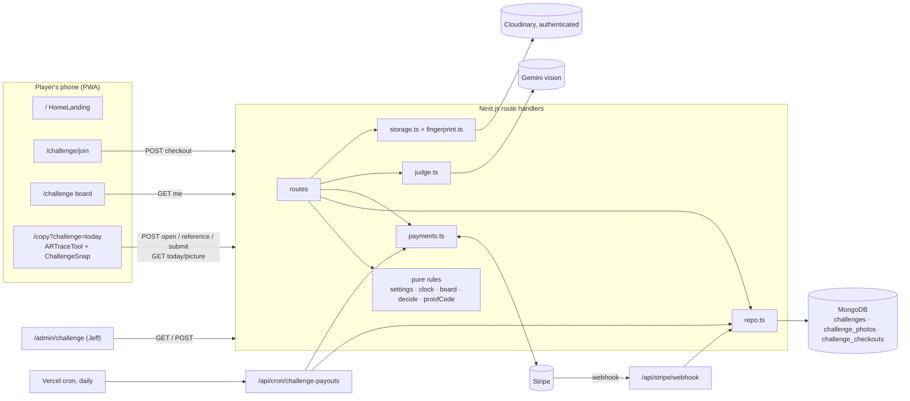

# 30-Day Drawing Challenge — Design

## Overview

The challenge is a thin, server-owned game layer on what the site already has: Google sign-in (next-auth), MongoDB
(`mural-app` database), Cloudinary for images, Gemini (`@google/genai`) for vision, and the trace tool
(`ARTraceTool`, which already loads a guided lesson through its `courseLesson` prop). Two outside pieces are added:
**Stripe** (the S$39 payment, dispute notices, the end refund) and a **daily Vercel cron** for payouts.

The game rules live in small pure modules under `src/lib/challenge/` (settings, clock, board, decide, proof code).
Route handlers do only I/O: check sign-in, load, apply the pure rules, save with guarded atomic updates. Money and
anti-cheat logic can then be unit-tested without a browser, a database or Stripe, and nothing about a day's result
or an amount is ever accepted from the device (R6.10).

Days are **derived, not scheduled**: tiles, "missed" and "over" are computed from the stored Day 1 date, time zone
and day records each time they're read. Stored `status` only changes for over-and-ended (lazily, before any join,
and by the cron), disputes and withdrawals.

## Architecture



**Submit flow:** the device posts the camera frame → route checks sign-in, challenge not over, today opened, day not
already passed, drawing time → fingerprints the photo and uploads it privately → atomically takes one of the day's
5 checks (`$inc` guarded on `checked < 5`) → asks Gemini for a structured verdict (25 s timeout) → `decide()` →
saves the photo and the day result with guards → returns result, messages, checks left and wallet.

## Components and interfaces

### Pure rules (`src/lib/challenge/`)

Shared types (`Challenge`, `DayRecord`, `Payout`, `PhotoDoc`, `CheckoutDoc`, `Verdict`, `Decision`) live in
`src/lib/challenge/types.ts`, so the pure modules don't depend on the adapters.

```ts
// settings.ts — the Settings table in requirements.md
export const SETTINGS = {
  priceCents: 3900, perDayCents: 100, days: 30,
  freeDays: [7, 14, 21, 28], lateJoinCutoffHour: 20,
  minDrawMinutes: 10, maxCheckedPerDay: 5, reviewLimitHours: 72,
  passScore: 70, failScore: 40, nearCopyBits: 6, judgeTimeoutMs: 25_000,
  checkoutPendingMinutes: 60,
  proofAlphabet: "ACDEFGHJKMNPQRTUVWXY34679", termsVersion: "2026-11-v1",
} as const;
export const MAX_PAYOUT_CENTS = SETTINGS.perDayCents * SETTINGS.days; // 3000

// clock.ts — Intl only, no new dependency
export function isValidTimeZone(tz: string): boolean;
export function localDate(instant: Date, tz: string): string;                 // "YYYY-MM-DD"
export function addDays(date: string, n: number): string;
export function startOfLocalDay(date: string, tz: string): Date;              // DST-safe
export function day1For(confirmedAt: Date, processedAt: Date, tz: string): string;
//   cutoff rule on confirmedAt, then never earlier than localDate(processedAt) (late webhooks)
export function dayNumberAt(c: ClockFields, at: Date): number;                // <1 before Day 1, >30 after Day 30
export function dayWindow(c: ClockFields, n: number): { start: Date; end: Date };

// board.ts
export type TileState = "passed" | "missed" | "review" | "today" | "locked";
// A review past reviewExpired() counts as passed everywhere below, even before the cron settles it (R7.4).
export function tileStates(c: Challenge, now: Date): TileState[];             // 30 entries
export function walletCents(c: Challenge, now: Date): number;                 // min(passed × 100, 3000)
export function possibleCents(c: Challenge, now: Date): number;               // wallet + 100 × days not passed that are not ended or are in review
export function streak(c: Challenge, now: Date): number;
export function isOver(c: Challenge, now: Date): boolean;                     // Day 30 ended, or disputed/withdrawn
export function reviewExpired(c: Challenge, day: number, now: Date): boolean; // now ≥ dayWindow.end + 72 h
export function payoutDue(c: Challenge, now: Date): boolean;                  // over, not disputed, no review left, no payout

// decide.ts
export type FailReason = "screen_or_print" | "not_drawing" | "bad_reference" | "code_missing" | "low_match";
export type ReviewReason = "between_thresholds" | "code_off_by_one" | "possible_copy" | "checker_unavailable";
export interface DecideInput {
  verdict: Verdict | null;              // null = Gemini error / timeout
  expectedCode: string;
  photoToOtherPhotosMinBits: number;    // vs passed/review proof photos of other days, all players
  freeDay?: { referenceToOwnHistoryMinBits: number };
}
export type Decision =
  | { result: "pass" }
  | { result: "fail"; reasons: FailReason[] }
  | { result: "review"; reason: ReviewReason };
export function decide(i: DecideInput): Decision;
export const FAIL_MESSAGES: Record<FailReason, string>;   // exactly the table in requirements R6

// proofCode.ts
export function newProofCode(used: string[], rand?: () => number): string;
export function codeDistance(read: string, expected: string): number;
//   upper-cased, spaces removed, Levenshtein distance (so a 3- or 5-character read is 1 away if one char is lost/added)
```

**`decide()` order:**

1. Fails that need no Gemini: free day and `referenceToOwnHistoryMinBits ≤ nearCopyBits` → `bad_reference`.
2. If `verdict === null`: any fails from step 1 → fail; else review `checker_unavailable`.
3. Collect the rest: `screenOrPrint` → `screen_or_print`; `!handDrawingOnPaper` → `not_drawing`; free day and
   `referenceIsHandDrawing` → `bad_reference`; `codeRead` empty or `codeDistance ≥ 2` → `code_missing`;
   `matchScore ≤ failScore` → `low_match`. Any collected → fail with all of them.
4. `codeDistance === 1` → review `code_off_by_one`.
5. `photoToOtherPhotosMinBits ≤ nearCopyBits` → review `possible_copy`.
6. `matchScore ≥ passScore` → pass; else review `between_thresholds`.

### Outside-service adapters (`src/lib/challenge/`), each mocked in tests

```ts
// judge.ts — Gemini structured JSON output; model from env GEMINI_JUDGE_MODEL (default "gemini-2.5-flash")
export interface Verdict {
  handDrawingOnPaper: boolean; screenOrPrint: boolean; matchScore: number;   // 0–100
  codeRead: string;                      // "" if none visible
  referenceIsHandDrawing?: boolean;      // free days only
  notes: string;
}
export function judgeProof(a: { photo: Buffer; reference: Buffer; freeDay: boolean; signal: AbortSignal })
  : Promise<Verdict>;                    // throws on timeout / invalid JSON

// fingerprint.ts — 64-bit difference hash with sharp (already installed)
export function fingerprint(img: Buffer): Promise<string>;  // 16 hex chars
export function bitDistance(a: string, b: string): number;

// storage.ts — Cloudinary type "authenticated" (R10.4)
export function putPrivate(img: Buffer, folder: "challenge/proof" | "challenge/ref"): Promise<string>; // publicId
export function signedUrl(publicId: string, ttlSeconds?: number): string;
export function deletePrivate(publicIds: string[]): Promise<void>;

// payments.ts — Stripe (new dependency "stripe")
export function createCheckout(a: { email: string; origin: string }): Promise<{ id: string; url: string }>;
//   mode "payment", SGD 3900, payment_method_types ["card", "paynow"], metadata { email, termsVersion },
//   expires_at = now + checkoutPendingMinutes (so "confirming" never outlives the session)
export function parseWebhook(rawBody: string, signature: string): Stripe.Event;    // throws on bad signature
export function refund(a: { paymentIntentId: string; amountCents: number; key: string })
  : Promise<{ refundId: string }>;
export function existingRefund(paymentIntentId: string, key: string): Promise<{ refundId: string } | null>;
//   refunds.list({ payment_intent }) filtered on metadata.key — used to settle a stuck "pending" payout

// repo.ts — Mongo access through getDb() (cached client added to src/app/utils/mongodb.ts)
export function ensureIndexes(): Promise<void>;          // memoised per server instance
export function activeChallenge(email: string, now: Date): Promise<Challenge | null>;
//   if the stored active challenge isOver(now), sets it "ended" (guarded on status) and returns null (R2.10)
export function insertChallenge(c: NewChallenge): Promise<"created" | "duplicate" | "already_active">;
export function takeCheck(id: ObjectId, day: number): Promise<boolean>;           // $inc guarded on checked < 5
export function giveBackCheck(id: ObjectId, day: number): Promise<void>;
export function settleDay(id: ObjectId, day: number, to: "passed" | "review" | "rejected",
  fields: Partial<DayRecord>, from: Array<DayRecord["result"] | undefined>): Promise<boolean>;
//   guarded: only moves from the listed states (first pass wins; admin/timeout only from "review")
export function claimPayout(id: ObjectId, amountCents: number): Promise<number | null>;
//   moves payout from none or "failed" to {status:"pending", attempt: n+1} only if status ≠ "disputed";
//   returns the attempt number (null if not claimed)
export function finishPayout(id: ObjectId, p: Payout): Promise<void>;

// payout.ts — one helper used by the cron and the admin "retry payout" action
export function runPayout(c: Challenge, now: Date): Promise<Payout>;
//   claimPayout → refund(walletCents, key `payout:<id>:<attempt>`) → finishPayout; S$0 → "skipped";
//   refund error → "failed" with the message
```

### API routes (all `runtime = "nodejs"`, `dynamic = "force-dynamic"`, responses `Cache-Control: no-store`)

| Route | In → out | Notes · requirements |
|---|---|---|
| `POST /api/challenge/checkout` | `{ timeZone, acceptedTerms: true }` → `{ url }` / `409 { redirect: "/challenge" }` | Rejects untick or bad zone (400). `activeChallenge()` first (ends an over one). Saves `challenge_checkouts { email, sessionId, timeZone, createdAt, state: "open" }`. R2.2, R2.3, R2.9, R2.10, R3.1, R10.2 |
| `POST /api/stripe/webhook` | Stripe event → 200 | `checkout.session.completed` with `payment_status = "paid"` and `checkout.session.async_payment_succeeded` → look up checkout record (time zone), `activeChallenge()`, `insertChallenge` with `day1For(event.created, now, tz)`; `"duplicate"` → no-op; `"already_active"` → full refund (key `dup:<paymentIntent>`). `checkout.session.async_payment_failed` / `checkout.session.expired` → checkout `state: "failed"`. `charge.dispute.created` → status `disputed`; pending payout left for admin. R2.4, R2.6–2.8, R9.6 |
| `GET /api/challenge/me` | → `{ state: "none" \| "confirming" \| "failed" \| "active" \| "ended", tiles, walletCents, possibleCents, streak, today?, payout?, passedDays: [{ day, photoUrl, referenceUrl }] }` | `confirming` = latest checkout record `open`/paid-but-not-yet-inserted and younger than 60 min; `failed` = latest record `failed` → join page shows "no money was taken". R2.5, R2.8, R8.1–8.2, R8.4–8.5, R10.1, R10.3 |
| `POST /api/challenge/today/open` | → `{ day, content, pictureUrl?, proofCode, drawingStartedAt?, checkedLeft, lateWarning }` | Idempotent; first call issues the code (`newProofCode(used)`); set day: drawing start = now. `lateWarning` when `dayWindow.end − now < 10 min`. R3.3, R4.1, R4.4–4.7, R5.1 |
| `GET /api/challenge/picture?day=N` | → image | Streams day N's reference: a set picture from `private/challenge/` (outside `public/`) or the player's own free-day reference (signed redirect). Only for days the signed-in player has opened, so future pictures can't be fetched early; used for today and for passed tiles. R4.5, R8.4 |
| `POST /api/challenge/today/reference` | multipart `reference` (the original file) → `{ ok }` | Free days only; private copy + fingerprint; sets drawing start (once). R4.2, R4.6, R6.4 |
| `POST /api/challenge/today/submit` | multipart `photo` (JPEG ≤ 3 MB) → `{ result, messages?, reviewReason?, checkedLeft, walletCents }` | `maxDuration = 60`. Order: over/disputed 409 → not opened 409 → already passed 409 → drawing time 425 (minutes left, not counted) → size/type 413/415 → `takeCheck` (429 if none left, nothing uploaded) → upload (503 + `giveBackCheck` on failure) → judge (free day: with the stored reference; near-copy pool for the reference = same player's earlier references and proof photos) → `decide` → `settleDay` (from `undefined`/`rejected`/`review` only) + `PhotoDoc`. R3.3, R5.4–5.8, R6.1–6.10, R10.3 |
| `GET /api/admin/challenge` | → `{ reviews, attention }` | Reviews oldest first with photo/reference URLs, codes, score, reason, time left (`reviewExpired`). Attention = payout `failed` or `pending` > 1 h, and `disputed`. R7.1, R7.6, R7.7 |
| `POST /api/admin/challenge` | `{ action: "approve" \| "reject", challengeId, day, photoId }` · `{ action: "retry-payout", challengeId }` · `{ action: "delete-request", email }` | Approve/reject guarded on day `review`, review not past `reviewExpired`, and challenge not paid out / disputed; retry-payout calls `runPayout` (only from `failed`); updates `PhotoDoc.result` for every review photo of that day (approved → `passedPhotoId`, others `failed`). Delete request: active challenge → `withdrawn` + `deleteRequestedAt`; no unpaid challenge → delete photos and photo docs now. R7.2, R7.3, R7.5, R9.4, R10.5 |
| `GET /api/cron/challenge-payouts` | `Authorization: Bearer $CRON_SECRET` → `{ processed }` | `maxDuration = 300`. Candidates: active, ended or withdrawn without a final payout. For each: end if over; review days past `reviewExpired` → `settleDay(passed, decidedBy: "timeout")`; `payoutDue` → `runPayout`; a `pending` older than 1 h → `existingRefund` to settle, never refund again; after payout, delete photos of withdrawn players. R3.6, R7.4, R9.1–9.5, R10.5 |

### Pages and UI

- **`/` → `HomeLanding`** (`src/components/site/HomeLanding.tsx`): hero (headline, S$39, earn back up to S$30,
  "Start the challenge"), "Try the trace tool free" → `/copy`, three steps, FAQ with the five R1.3 topics. CTA uses
  `useSession()` + `me` to switch to "Go to today". Reuses `playful.css`, the fonts already in `layout.tsx`,
  `SiteNav` (links changed to How it works / FAQ / Trace tool) and `SiteFooter` (adds the three services links).
  R1.1–1.5.
- **`/challenge/join`**: rules, link to terms, accept checkbox, "Pay S$39" disabled until ticked; signed out →
  `signIn("google", { callbackUrl: "/challenge/join" })`; `?cancelled=1` or `me.state = "failed"` → "No money was
  taken". R2.1, R2.2, R2.8, R2.9.
- **`/challenge/terms`**: rules, refund terms (S$9 non-refundable), privacy, deletion. R2.2.
- **`/challenge`** board: 5 × 6 tiles, wallet meter ("S$12 of S$30"), possible, streak, "Draw today", tile sheet with
  photo vs reference, ended view with payout status. While `confirming`, polls `me` every 5 s. Celebration (coin
  count-up + confetti with the existing `motion` library) after a pass result, and on the board when a tile moves to
  `passed` since the last visit (last-seen state kept in `localStorage`, display only). R2.5, R8.1–8.5.
- **`/copy?challenge=today`**: `src/app/copy/page.tsx` renders `ChallengeTrace`, which calls `today/open`, renders
  `ARTraceTool` with `courseLesson` (set day, image = `/api/challenge/picture?day=N`) and the new `challenge` prop, and opens the
  `ChallengeSnap` sheet (confirm → submit → result, messages, checks left). Shows the late warning. R4.4, R4.7,
  R5.3, R5.8, R6.8.
- **`/admin/challenge`**: review cards with Approve / Reject per photo, attention list with Retry payout,
  delete-request form. R7.1–7.7, R9.4, R10.5.

### Changes to `ARTraceTool`

One optional prop; without it the tool renders exactly as today:

```ts
challenge?: {
  day: number; proofCode: string; freeDay: boolean;
  onSnap: (photo: Blob) => void;               // raw camera frame, no overlay
  onReferenceChosen?: (file: File) => void;    // free days: the original File from handleImageUpload, before sketching
}
```

With `challenge` set the tool shows a pill ("Day 6 · write **K7MX** in a corner") and a "Snap my drawing" button.
Snap draws only `videoRef.current` onto a canvas (longest side 1600 px) and calls `onSnap` with a JPEG blob; the
overlay is a separate DOM layer, so it is never in the frame (R5.3). The only file input stays the reference picker;
nothing from it reaches `onSnap` (R5.4).

### Service-worker caching (`next.config.ts`)

Workbox tests a RegExp `urlPattern` against the full `url.href`, so the current `^\/api\/` and `^\/` rules never
match. New rules, placed first, use function matchers:
`({ url }) => url.pathname.startsWith("/api/challenge") || url.pathname.startsWith("/api/admin") ||
url.pathname.startsWith("/challenge") || url.pathname.startsWith("/admin")` → `NetworkOnly`. The two dead rules are
rewritten as function matchers with the same intent, excluding the paths above. R10.1.

## Data models

```ts
// "challenges"
interface Challenge {
  _id: ObjectId;
  email: string;                                   // lower-case Google email
  status: "active" | "ended" | "disputed" | "withdrawn";
  timeZone: string;                                // IANA, from checkout
  day1: string;                                    // "YYYY-MM-DD" in timeZone
  createdAt: Date;
  termsVersion: string;
  payment: { checkoutSessionId: string; paymentIntentId: string; amountCents: number; currency: "sgd" };
  days: Partial<Record<`${number}`, DayRecord>>;   // "1".."30"
  payout?: Payout;
  deleteRequestedAt?: Date;
}
interface DayRecord {
  openedAt: Date;
  proofCode: string;
  drawingStartedAt?: Date;                          // set day: openedAt; free day: reference chosen
  referenceId?: string; referenceFp?: string;       // free days
  checked: number;
  result?: "passed" | "review" | "rejected";
  decidedBy?: "auto" | "admin" | "timeout";
  reviewReason?: ReviewReason;
  reviewPhotoIds?: string[];                        // every photo that put the day in review
  passedPhotoId?: string;
}
interface Payout {
  status: "pending" | "paid" | "skipped" | "failed";
  attempt: number; amountCents: number; refundId?: string; error?: string; at: Date;
}

// "challenge_photos" — checked proof photos and free-day references
interface PhotoDoc {
  _id: ObjectId; challengeId: ObjectId; email: string; day: number;
  kind: "proof" | "reference";
  publicId: string; fp: string; at: Date;
  result?: "passed" | "review" | "failed";          // kept in step with the day's settlement
  decision?: Decision; verdict?: Verdict | null;
}

// "challenge_checkouts"
interface CheckoutDoc {
  _id: ObjectId; email: string; sessionId: string; timeZone: string; createdAt: Date;
  state: "open" | "paid" | "failed";
}
```

Indexes (`ensureIndexes`, memoised): `challenges.payment.paymentIntentId` unique (R2.6); partial unique `{ email }`
where `status: "active"` (A7, R2.7); `challenges.status`; `challenge_photos { kind, result }`, `{ email, kind }`;
`challenge_checkouts.sessionId` unique, `{ email, createdAt }`.

Environment: `STRIPE_SECRET_KEY`, `STRIPE_WEBHOOK_SECRET`, `ADMIN_EMAILS`, `CRON_SECRET`, optional
`GEMINI_JUDGE_MODEL`. `vercel.json`: daily cron `0 19 * * *` (03:00 Singapore), which works on every Vercel plan;
payouts land within a day of becoming due.

## Changes

| File / module | Change | Requirements |
|---|---|---|
| `src/lib/challenge/settings.ts` (new) | Settings | R4.3, R5.5–5.6, R6.6–6.9, R7.4, R9.5 |
| `src/lib/challenge/clock.ts` (new) | Day maths | R2.4, R3.1–3.3, R3.6, R4.5, R4.7 |
| `src/lib/challenge/board.ts` (new) | Tiles, wallet, streak, review expiry, payout due | R3.4–3.5, R7.4, R8.1–8.2, R8.5, R9.1, R9.5 |
| `src/lib/challenge/decide.ts` (new) | Decision table, messages | R5.7, R6.2–6.9 |
| `src/lib/challenge/proofCode.ts` (new) | Codes, distance | R5.1, R6.5 |
| `src/lib/challenge/curriculum.ts` (new), `private/challenge/day-XX.*` (new) | 30-day content; Days 1–5 wrap `FACE_COURSE` | R4.1–4.3, R4.5 |
| `src/lib/challenge/fingerprint.ts` (new) | dHash | R6.3, R6.4 |
| `src/lib/challenge/judge.ts` (new) | Gemini verdict | R6.1–6.2, R6.4, R6.9 |
| `src/lib/challenge/storage.ts` (new) | Private Cloudinary | R10.4, R10.5 |
| `src/lib/challenge/payments.ts` (new), `package.json` (`stripe`) | Checkout, webhook, refunds | R2.3–2.8, R9.1–9.6 |
| `src/lib/challenge/repo.ts` (new), `src/app/utils/mongodb.ts` (add cached `getDb()`) | Guarded writes, indexes | R2.6–2.7, R2.10, R5.6–5.7, R7.2–7.5, R9.3, R9.6, R10.3 |
| `src/lib/auth.ts` (new), `src/app/api/auth/[...nextauth]/route.ts` | Move `authOptions` (route files can't export it); `requirePlayer`, `requireAdmin` | R7.6, R10.2–10.3 |
| `src/app/api/challenge/checkout/route.ts` (new) | Start payment | R2.2–2.3, R2.9–2.10, R3.1 |
| `src/app/api/stripe/webhook/route.ts` (new) | Payment events | R2.4, R2.6–2.8, R9.6 |
| `src/app/api/challenge/me/route.ts` (new) | Board data | R2.5, R2.8, R8.1–8.2, R8.4–8.5, R10.1, R10.3 |
| `src/app/api/challenge/today/{open,reference}/route.ts`, `src/app/api/challenge/picture/route.ts` (new) | Day start, free-day reference, reference pictures | R3.3, R4.1–4.7, R5.1, R8.4 |
| `src/app/api/challenge/today/submit/route.ts` (new) | Proof submission | R3.3, R5.4–5.8, R6.1–6.10 |
| `src/app/api/admin/challenge/route.ts` (new) | Review, retry payout, delete request | R7.1–7.7, R9.4, R10.5 |
| `src/app/api/cron/challenge-payouts/route.ts` (new), `vercel.json` (new) | Payouts, review timeout, photo deletion | R3.6, R7.4, R9.1–9.5, R10.5 |
| `src/components/ARTraceTool.tsx` | `challenge` prop | R4.4, R5.2–5.4, R6.4 |
| `src/app/copy/page.tsx` | `?challenge=today` → `ChallengeTrace` | R4.4 |
| `src/components/challenge/{ChallengeTrace,ChallengeSnap,Board,Celebration}.tsx` (new) | Challenge UI | R4.4, R4.7, R5.3, R5.8, R6.8, R8.1–8.5 |
| `src/app/challenge/{page,join/page,terms/page}.tsx` (new) | Board, join, terms | R2.1–2.2, R2.5, R2.8–2.9, R8 |
| `src/app/admin/challenge/page.tsx` (new) | Review page | R7.1–7.7, R9.4, R10.5 |
| `src/components/site/HomeLanding.tsx` (new), `src/app/page.tsx`, `src/components/site/SiteNav.tsx`, `src/components/site/SiteFooter.tsx` | New homepage, services links in footer | R1.1–1.5 |
| `src/components/site/HomePlayful.tsx`, `src/components/site/ScrollStory.tsx`, `src/app/App_Sketch.jsx` | Deleted (replaced / already unused) | R1 |
| `next.config.ts` | Function-matcher `NetworkOnly` rules first; dead RegExp rules fixed | R10.1 |
| `.gitignore` | Ignore `.env` (untracked and not ignored today) | Constraint: secrets never committed |
| `src/lib/challenge/types.ts` (new) | Shared types | All R (types only) |
| `src/lib/challenge/payout.ts` (new) | `runPayout` for cron and admin retry | R9.1–9.4 |
| `scripts/calibrate-judge.ts` (new) | Runs judge + fingerprint + decide over a labelled photo folder, prints a confusion table | R6.6–6.9 thresholds |
| `vitest.config.ts` (new), `package.json` (`vitest`, `mongodb-memory-server`, `jsdom`, `@testing-library/react`) | Test runner for the tests below | Testing strategy (all R) |

## Reuse and deletion

**Built on:** next-auth Google provider and the `/auth` sign-in page; the existing Mongo URI and database name, now
behind a cached `getDb()` in `src/app/utils/mongodb.ts`; Cloudinary config as in `upload-cloudinary`; `@google/genai`
as in `generate-image-gemini`; `sharp`; `ARTraceTool`'s `courseLesson` loading (opacity, strobe, image) for set days;
`FACE_COURSE` lessons for Days 1–5; `playful.css`, the fonts, `SiteNav`, `SiteFooter`; `motion`; the PWA setup.

**Removed in this feature:** `HomePlayful.tsx` and `ScrollStory.tsx` (replaced by `HomeLanding`), `App_Sketch.jsx`
(already unimported), the `authOptions` constant in the nextauth route (moved).

**Kept, flagged as an open question:** `/app` and `/app/course` (the earlier app landing) and `src/middleware.ts`,
which rewrites `/` to `/app` on `app.*` hosts, so the new homepage does not show on an `app.` subdomain.

## Error handling

| Failure | What happens |
|---|---|
| Signed out on a challenge API | 401; pages show a sign-in button (R10.2) |
| Another player's data | Not addressable: player routes load by session email; admin routes need an admin (R10.3, R7.6) |
| Checkout creation fails | Join page: "Couldn't open payment. No money was taken." with retry |
| Webhook bad signature | 400, nothing written |
| Webhook repeated / out of order | Unique payment intent → no-op (R2.6) |
| Webhook days late | Day 1 clamped to the processing date (no pre-missed days) |
| Second payment while active | Full refund, key `dup:<paymentIntent>`; refusal → attention list (R2.7) |
| Rejoin after Day 30 before cron ran | `activeChallenge()` ends the over challenge first, so the insert succeeds (R2.10) |
| PayNow confirming / failed / expired | Board polls "confirming"; failed/expired → join page "no money was taken" (R2.5, R2.8) |
| Gemini timeout / error / bad JSON | Review `checker_unavailable` unless a no-Gemini check already failed (R6.9) |
| Cloudinary upload fails | 503 "Couldn't save your photo, try again"; check not taken |
| Two submits at once | `takeCheck` guard keeps the limit; `settleDay` guard keeps the first pass (R5.6, R5.7) |
| Mongo unavailable | 503 with retry; the snapped photo stays in memory on the device for retry |
| Photo too large / not an image | 413 / 415, not counted |
| Submission after midnight | Counts for the day it arrived in; a new day not yet opened → 409 "Open today's picture first" (R3.3) |
| Refund refused | `payout.failed` with the Stripe error; board "needs attention"; admin Retry (R9.4) |
| Cron overlaps / crashes mid-payout | `claimPayout` guard; stuck `pending` settled from `existingRefund`, never re-refunded (Stripe keys expire after 24 h) (R9.3) |
| Dispute during or after the challenge | `disputed`; `claimPayout` refuses; admin list shows it (R9.6) |

## Testing strategy

- **Unit (Vitest, node)** — the pure modules: `clock` (Singapore; `Europe/London` across both clock changes; 23:59
  vs the 20:00 cutoff; late webhook clamp; Day 30 end), `board` (tiles, wallet cap, possible, streak, review expiry,
  payout due), `decide` (every row, every reason, every message, ordering cases), `proofCode` (alphabet, no repeats,
  Levenshtein incl. 3/5-char reads), `curriculum` (30 days, free days from settings, every set image exists under
  `private/challenge/`), `fingerprint` (identical image resized/recompressed → ≤ 6 bits; unrelated → > 6).
- **Route integration (Vitest + mongodb-memory-server)** — handlers called directly; `getServerSession`, `payments`,
  `judge`, `storage` mocked. Covers sign-in and ownership, checkout gating, webhook idempotency/duplicates/disputes/
  failures, open/picture/reference/submit pre-checks and guards (including parallel submits), admin guards and
  settlement, cron payout amounts, once-only refunds, stuck-pending settlement, deletion.
- **Config test** — imports the runtime-caching array and matches full `https://host/…` URLs the way Workbox does
  (RegExp against `href`, function matchers against `{ url }`); the first match for challenge/admin URLs must be
  `NetworkOnly`, and a negative case (`/copy`, a font URL) must not be (R10.1).
- **Component (Vitest + jsdom + Testing Library)** — `HomeLanding` (content, free-tool link, CTA switches with
  `useSession` and `me` mocked), `SiteFooter` links, `ChallengeSnap` (no file input; the 30 s "taking longer"
  message with fake timers), join page checkbox gating.
- **Static check** — `onSnap(` is called exactly once in `ARTraceTool.tsx`, inside the snap handler that draws only
  `videoRef.current` (R5.4).
- **Manual, in the browser preview during implementation** — R1 layout at 375 × 667, signed-out join round trip,
  board look, celebration (R8.3), camera snap without overlay on a phone (R5.3), the proof-code pill (R5.2), Stripe
  test-mode card and PayNow end to end.
- **Judge calibration before launch (script, not CI)** — `judgeProof` + `fingerprint` + `decide` over a labelled
  folder of real photos: honest tracings vs reference, unrelated drawings on white paper, screens, printouts, no
  code, wrong picture. Tune `passScore`, `failScore`, `nearCopyBits`.

## Risks

- **Stale PWA data.** Caught by the config test (which uses full URLs, as Workbox does) and `no-store`.
- **Moving `authOptions`** could break sign-in for upload/mural flows; the route keeps identical behaviour and a test
  imports both.
- **`ARTraceTool` is 3,000+ lines.** The prop is additive and off by default; checked by hand in the preview.
- **Gemini judging is not deterministic** and may be fooled or too strict; mitigated by the review band, proof code,
  fingerprints → review (not fail), calibration, and the fact cheating can't profit.
- **PayNow partial refunds** may be limited by Stripe; failures surface for manual payment (A10).
- **In-memory fingerprint matching** is linear; fine for v1, revisit beyond ~50k photos.
- **Uncommitted work in the tree** (homepage, `/app`, waitlist, PayNow QR helper, `.env`) must be committed or set
  aside before implementation so the challenge changes review cleanly.
